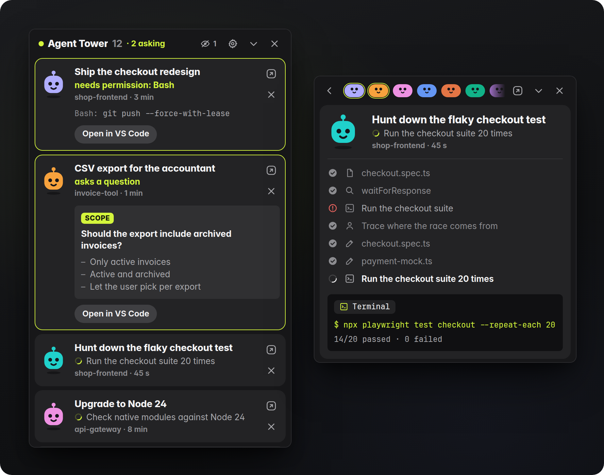

# Agent Tower

A Claude Code session that waits for your answer does nothing until you look. Agent Tower keeps those sessions in view. It is a small window in the corner of your Windows desktop that lists every running session, puts the ones that need you on top and opens the right VS Code tab with one click.



*The screenshots show made-up demo sessions.*

## Why

Three sessions you can keep in your head. Twelve you can't. One is waiting for permission to push, another asked you a question twenty minutes ago, and two finished long ago without anyone reading what they wrote. Each of them has left a hint somewhere, on a tab in a VS Code window hidden behind the browser.

Meanwhile those agents sit idle, and the work they would do next waits for a single "yes". Agent Tower is about that gap: the minutes between Claude needing you and you knowing it.

## What it does

Sessions that wait for a permission, an answer or a plan approval get a lime frame and move to the top. The header counts them ("2 asking") and keeps counting when you fold the window down to that one line. A permission prompt raised by a subagent shows up on its parent's row, because that is where you answer it.

The card tells you what the session wants before you switch: the command it wants to run, or the question with its options. Often that is enough to know whether it takes two seconds or real thought. A click on the row opens the session's latest steps and the last terminal command with its output, and the coloured faces at the top switch between sessions.

The arrow takes you there. For a session in VS Code it brings that window and tab to the front; a session in the Claude desktop app opens in the app. When the target is unclear, for example because no VS Code window shows the session's folder, the row says so instead of guessing.


Everything else stays quiet. A working session shows the step it is on. A finished one in VS Code shows a lime dot until you have read it there, then a grey one. After four hours a finished session shrinks to a single line; the settings offer 30 minutes up to 8 hours. The X hides a row until its state changes. The list updates every second.

## What it leaves alone

Agent Tower reads. It installs no hooks, writes nothing into Claude Code's folders and has no button that ends a session or a process. Its state (hidden rows and your settings) lives in a folder of its own, and the daemon listens on `127.0.0.1` only. Quit it and nothing changes for your sessions; they never knew it was there.

It also does not pretend. A long-running command can look like a permission prompt, so when Agent Tower cannot prove that a session is asking, the row says "probably asking" behind a dashed frame instead of the lime one. A value it cannot know is shown as a dash, not as a plausible guess.

## Where it runs

Agent Tower is made for one setup: Windows 11 with Claude Code in WSL 2, used through the VS Code extension. Sessions of Claude Code on Windows itself, in VS Code or in the Claude desktop app, appear in the same list. Cloud sessions of the desktop app leave no trace on the machine and are missing. macOS and Linux desktops are not supported.

It shows and points; it does not answer. Allowing, denying and replying still happen in VS Code.

There are two programs. A daemon in WSL (`src/`, Node without packages) reads Claude Code's session registry and transcripts and serves the widget page from `public/` on `http://127.0.0.1:4188`. The Windows shell (`shell/`, WPF with WebView2) shows that page in a frameless window with a tray icon, and starts the daemon when it does not answer.

If you would rather have a map than a list, with the Git state of every repository and a 3D view, look at the playful sibling [Agent Colony](https://github.com/aploe/agent-colony). Agent Tower reuses its session logic and leaves out everything you would have to explore.

## Requirements

- WSL 2 with Node 22.13 or newer (the read marks taken from VS Code need the built-in `node:sqlite`; with an older Node they stay unknown). The scripts look for the nvm version named in `.nvmrc` first, then for `node` on the `PATH`.
- On Windows the .NET 10 SDK and the WebView2 runtime, which Windows 11 brings along.
- For the arrow: VS Code with the Claude Code extension, and `wslview` in WSL (package `wslu`).

## Install

Run this in WSL:

```
./scripts/build-shell.sh
```

It publishes the shell to `%LOCALAPPDATA%\AgentTower\app\`, writes `settings.json` one folder up if there is none yet, and puts "Agent Tower" into the Start Menu. With `--test` it runs the shell's unit tests first. The app has to be closed while it is rebuilt (tray icon, "Quit"); the script says so when the exe is still in use.

Start the app from the Start Menu. It checks whether the daemon answers and starts it if not. The header's X hides the window, a left click on the tray icon brings it back. The gear in the header opens the settings: start with Windows, always on top, and after how long a finished session moves to the slim rows.

## The daemon by hand

```
./scripts/start-server.sh    # starts it; a second call restarts it
./scripts/stop-server.sh
```

The daemon writes its log to `/tmp/agent-tower.log`, and the page opens in any browser at `http://127.0.0.1:4188/`. Quitting the app leaves the daemon running. For another port set `"port"` in the shell's `settings.json`; the shell hands it to the start script. Started by hand, the script takes the port from `TOWER_PORT` or from the config file.

## Where things live

| What | Where |
|------|-------|
| Shell settings: `distro`, `repoPath`, `port`, `topmost` | `%LOCALAPPDATA%\AgentTower\settings.json` |
| Window position | `%LOCALAPPDATA%\AgentTower\window.json` |
| WebView2 profile | `%LOCALAPPDATA%\AgentTower\WebView2\` |
| Hidden rows | `~/.local/state/agent-tower/dismissed.json`, or under `$XDG_STATE_HOME` if that is set |
| Daemon config | `config/tower.config.json`, with overrides for this machine in `config/tower.local.json` |
| Daemon settings changed in the widget | `~/.local/state/agent-tower/settings.json`; they override both config files |

## Checks

`npm test` runs the daemon's and the page's unit tests. `node scripts/check-live.mjs` compares the daemon's session list with `claude agents --json`, and `node src/collect.mjs --explain <session-id-prefix>` prints why a row has its state. `node scripts/shot.mjs out.png` takes a screenshot of the page; `--fixture all-states` shows every kind of row without live sessions, and `--fixture demo` shows the made-up sessions from the screenshots above.

## Uninstall

Switch off "Start with Windows" in the widget's settings, or delete the value `AgentTower` under `HKCU\Software\Microsoft\Windows\CurrentVersion\Run` by hand. Quit the app and run `./scripts/stop-server.sh`. Then delete the folder `%LOCALAPPDATA%\AgentTower`, the shortcut `Agent Tower.lnk` in `%APPDATA%\Microsoft\Windows\Start Menu\Programs\`, and `~/.local/state/agent-tower` in WSL.

## Credits

The look of the widget follows the "Agent Huddle" widget shown in an [Instagram reel by alextsoi_ai](https://www.instagram.com/reel/Dfphrw3griE/). Figures and code are not taken from it.

## Licence

PolyForm Internal Use License 1.0.0, see `LICENSE`: you may use and change Agent Tower, also inside your company, but you may not distribute it. Bundled fonts and the code taken over from Agent Colony are listed in `LICENSES.md`.
